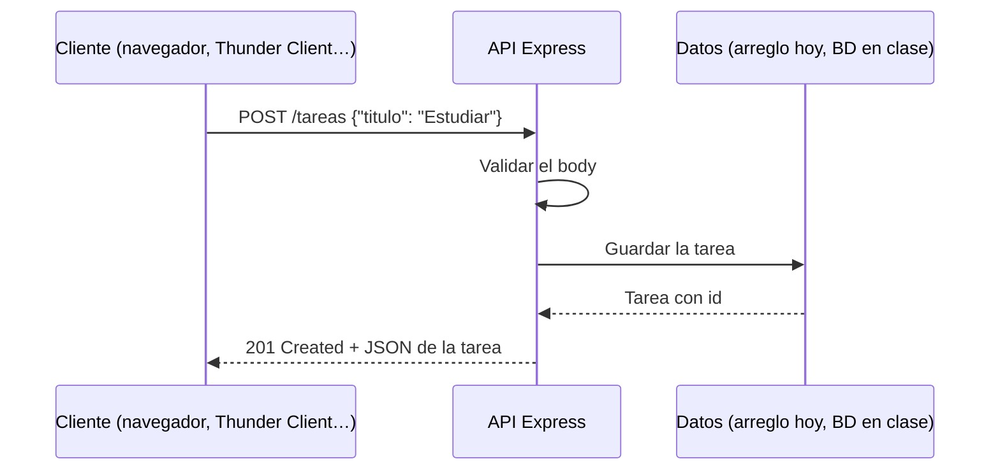
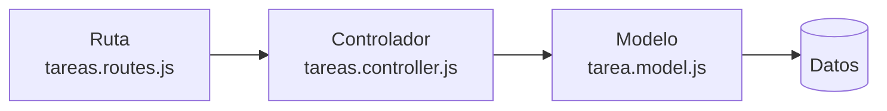

# Práctica: API REST de Tareas y Contactos con Node.js + Express

**Fundamentos Web · Grupo 611 · UNIAJC · Semestre 2-2026**

> **Sesión del 26 de noviembre: trabajo autónomo.** El docente no estará en clase ese día; esta guía está escrita para que avances a tu ritmo, solo/a o en pareja.
>
> - **Hoy:** dejas la API funcionando **en memoria** y **bien organizada**, y haces el **onboarding de bases de datos** si nunca has trabajado con una.
> - **Próxima clase presencial:** conectamos la API a una base de datos **todos juntos**, con la [Guía de Base de Datos](docs/GUIA_BASE_DE_DATOS.md).

---

## Ruta de la práctica

| # | Qué | Dónde | Cuándo |
| --- | --- | --- | --- |
| 0 | Repasar el JavaScript que vas a usar (arrays, objetos, funciones flecha, callbacks, promesas…) | [Repaso de JavaScript](docs/REPASO_JAVASCRIPT.md) | Hoy, **antes de empezar** si estás aprendiendo JS |
| 1 | Entender qué es una API y REST | [Sección 1](#1-conceptos-qué-es-una-api) + video de midudev | Hoy |
| 2 | Preparar el proyecto y corregir 2 errores del repo base | [Secciones 3 y 4](#3-preparar-el-proyecto) | Hoy |
| 3 | Completar la API de **tareas** | [Parte 1](#5-parte-1-completar-la-api-de-tareas) | Hoy |
| 4 | Construir la API de **contactos** | [Parte 2](#6-parte-2-construir-la-api-de-contactos-desde-cero) | Hoy |
| 5 | Organizar en rutas / controladores / modelos | [Parte 3](#7-parte-3-organizar-el-código-rutas-controladores-y-modelos) | Hoy |
| 6 | Onboarding de bases de datos (SQL básico) | [Guía BD, Parte A](docs/GUIA_BASE_DE_DATOS.md#parte-a-onboarding-qué-es-una-base-de-datos) | Hoy (obligatorio si nunca has usado BD) |
| 7 | Conectar la API a SQLite | [Guía BD, Parte B](docs/GUIA_BASE_DE_DATOS.md#parte-b-conectar-la-api-a-sqlite-en-clase) | **En clase** |

## Contenido

1. [Conceptos: ¿qué es una API?](#1-conceptos-qué-es-una-api)
2. [Material de apoyo](#2-material-de-apoyo)
3. [Preparar el proyecto](#3-preparar-el-proyecto)
4. [Paso 0: dos errores del repo base](#4-paso-0-dos-errores-del-repo-base)
5. [Parte 1: completar la API de tareas](#5-parte-1-completar-la-api-de-tareas)
6. [Parte 2: construir la API de contactos](#6-parte-2-construir-la-api-de-contactos-desde-cero)
7. [Parte 3: rutas, controladores y modelos](#7-parte-3-organizar-el-código-rutas-controladores-y-modelos)
8. [Cómo probar tu API](#8-cómo-probar-tu-api)
9. [Parte 4: base de datos](#9-parte-4-base-de-datos)
10. [Retos opcionales](#10-retos-opcionales)
11. [Entrega y criterios](#11-entrega-y-criterios-de-evaluación)
12. [Errores comunes](#12-errores-comunes)

---

## 1. Conceptos: ¿qué es una API?

### La analogía del restaurante

Tú eres el **cliente** y la cocina es el **servidor**, donde se preparan los platos (los datos). No entras a la cocina: le pides al **mesero**. **El mesero es la API.**

1. **Petición (request):** le das tu orden al mesero → `GET /tareas`
2. **Procesamiento:** la cocina prepara el plato → el servidor busca las tareas
3. **Respuesta (response):** el mesero te trae el plato → `200 OK` + JSON con las tareas

Una API define **qué pedidos se pueden hacer**, **cómo** hacerlos y **qué se recibe** de vuelta. El cliente no necesita saber cómo funciona la cocina por dentro (si los datos están en un arreglo o en una base de datos).



### Node.js y Express

- **Node.js** permite ejecutar JavaScript **fuera del navegador**, en el servidor (la cocina). Con él construimos lógica de negocio, accedemos a bases de datos y creamos APIs.
- **Express** es una librería para Node.js que simplifica crear servidores: definir **rutas** (`/tareas`), atender **métodos HTTP** y responder en JSON. Sin Express tendrías que hacer todo con el módulo `http` nativo (lo verás al inicio del video de midudev).

### REST: recursos y verbos

REST no es una tecnología sino un **estilo** de diseño de APIs. La idea central: todo es un **recurso** (una tarea, un contacto) y se identifica con una URL que es un **sustantivo en plural**. La **acción** la indica el **verbo HTTP**.

| Verbo | URL | Acción | CRUD |
| --- | --- | --- | --- |
| `GET` | `/tareas` | Listar todas las tareas | **R**ead |
| `GET` | `/tareas/3` | Obtener la tarea con id 3 | **R**ead |
| `POST` | `/tareas` | Crear una tarea (datos en el body) | **C**reate |
| `PUT` | `/tareas/3` | Actualizar la tarea 3 | **U**pdate |
| `PATCH` | `/tareas/3` | Actualizar **parcialmente** la tarea 3 | **U**pdate |
| `DELETE` | `/tareas/3` | Eliminar la tarea 3 | **D**elete |

✅ Bien: `GET /tareas`, `DELETE /contactos/5`
❌ Mal: `/getTareas`, `/crearContacto`, `/borrarTarea?id=5` (el verbo va en el método HTTP, no en la URL).

Otras dos reglas de REST:

- **Sin estado (stateless):** cada petición trae toda la información necesaria. El servidor no "recuerda" peticiones anteriores del cliente.
- **Representación en JSON:** los datos viajan en un formato estándar, legible por personas y máquinas.

### Las tres formas de enviarle datos a la API

| Dónde | Ejemplo | En Express | Se usa para |
| --- | --- | --- | --- |
| Parámetro de ruta | `/tareas/3` | `req.params.id` → `"3"` (texto) | Identificar **un** recurso |
| Query string | `/tareas?completada=true` | `req.query.completada` → `"true"` | Filtrar, ordenar, paginar |
| Body (cuerpo) | `{ "titulo": "Estudiar" }` | `req.body.titulo` (requiere `express.json()`) | Enviar los datos a crear o actualizar |

### API externa vs. API local

- **API externa:** vive en internet y la mantiene otra empresa (ej.: NewsAPI, PokéAPI). Ventaja: datos reales sin mantenerlos tú. Desventajas: dependes de un tercero, hay límites de peticiones, a veces cuesta, y necesitas una **API key** que **nunca** debe quedar publicada en el código de un repo público.
- **API local:** la que construyes tú y corre en tu máquina en `http://localhost:3000`. `localhost` significa "este mismo computador": las peticiones no salen a internet. Control total, ideal para desarrollar.

En el repo [newspaper-api](https://github.com/uniajc-gperezm/newspaper-api) ves las dos: el frontend consume NewsAPI y luego se cambia a una API local propia.

---

## 2. Material de apoyo

| Recurso | Qué tomar de ahí |
| --- | --- |
| 📘 [Repaso de JavaScript](docs/REPASO_JAVASCRIPT.md) | Los conceptos de JS que usa esta práctica, con ejemplos del proyecto y enlaces a las clases gratuitas de [aprendejavascript.dev](https://aprendejavascript.dev) (midudev). |
| 🎥 [midudev: *Creamos una API desde cero* (clase 2)](https://www.youtube.com/watch?v=YmZE1HXjpd4) | **Obligatorio.** Del módulo `http` nativo a Express, `express.json()`, rutas, `req.body`, códigos de estado y pruebas con un archivo `.http`. |
| 📁 [midudev/curso-node-js](https://github.com/midudev/curso-node-js) | Código de cada clase. `clase-2`: Express básico. `clase-3`: CRUD de películas. `clase-4`: arquitectura con `routes/`, `controllers/`, `models/`. `clase-5`: bases de datos (para la clase presencial). |
| 📁 [uniajc-gperezm/newspaper-api](https://github.com/uniajc-gperezm/newspaper-api) | Ejemplo guía de la materia: `crud-api/app.js` (CRUD completo en memoria) y la sección 2 de `2_GUIA_AVANZADA.md` (separar rutas y controladores). |
| 📁 [uniajc-gperezm/contact-list-server](https://github.com/uniajc-gperezm/contact-list-server) | API de contactos del semestre anterior: referencia de validación de campos. Úsala para comparar, **no para copiar**. |
| 📄 [Express: guía de rutas](https://expressjs.com/es/guide/routing.html) | Documentación oficial de `app.get`, `app.post`, `express.Router()`. |
| 📄 [MDN: códigos de estado HTTP](https://developer.mozilla.org/es/docs/Web/HTTP/Status) | Para elegir el código correcto en cada respuesta. |

> **Ojo con las versiones:** este repo usa **Express 5**. El curso de midudev y newspaper-api usan Express 4. Para esta práctica funcionan igual, **excepto** por el detalle del Paso 0.2.

---

## 3. Preparar el proyecto

**Requisitos:** Git, VS Code y **Node.js 22.13 o superior** (recomendado: la versión **LTS** actual de [nodejs.org](https://nodejs.org)). Revisa con `node -v`. La versión importa para la clase de base de datos.

1. Crea **tu propio repositorio** a partir de esta plantilla: botón verde **Use this template → Create a new repository**.
   - *Owner:* tu usuario. *Repository name:* `api-tareas-contactos-611`. Visibilidad: **Public**.
   - No uses *Fork*: en un fork, GitHub Actions viene **desactivado** y no verías tus pruebas automáticas.
2. Clona **tu** repositorio:

   ```bash
   git clone https://github.com/TU_USUARIO/api-tareas-contactos-611.git
   cd api-tareas-contactos-611
   ```

3. Instala las dependencias (se crea `node_modules/`, que **no** se sube a GitHub gracias al `.gitignore`):

   ```bash
   npm install
   ```

4. Levanta el servidor en modo desarrollo (`nodemon` lo reinicia cada vez que guardas un archivo):

   ```bash
   npm run dev
   ```

5. Abre <http://localhost:3000/tareas>. Deberías ver 3 tareas en JSON.

### ¿Qué trae el repo?

```
.
├── package.json              → dependencias (express, nodemon) y scripts (start, dev, test, sql)
├── .github/workflows/        → integración continua: corre las pruebas en cada push (no lo modifiques)
├── tests/                    → pruebas automáticas visibles (no las modifiques)
├── scripts/sql-playground.js → para practicar SQL (Guía de BD)
├── docs/
│   ├── REPASO_JAVASCRIPT.md  → los conceptos de JS que usa la práctica
│   ├── GUIA_BASE_DE_DATOS.md → onboarding e integración de base de datos
│   └── sql/practica.sql      → ejercicios de SQL
└── src/
    ├── index.js              → un "Hola mundo" de la clase anterior (no es la API)
    └── server.js             → la API de tareas: GET y POST funcionan; PUT y DELETE están comentados
```

---

## 4. Paso 0: dos errores del repo base

Son errores reales que te vas a encontrar en cualquier proyecto. Corrígelos antes de programar.

### 0.1 `npm start` no arranca la API

Ejecuta `npm start`: imprime *"Hola mundo desde Node.js…"* y termina. Mira `package.json`:

```json
"start": "node src/index.js",
"dev": "nodemon src/server.js"
```

`start` apunta al archivo equivocado. Ambos scripts deben ejecutar **el mismo** punto de entrada. Cambia **solo** esas dos líneas (`main` y `start`) y deja los demás scripts como están:

```json
"main": "src/server.js",
"scripts": {
  "test": "node --test --test-concurrency=1 \"tests/*.test.js\"",
  "start": "node src/server.js",
  "dev": "nodemon src/server.js",
  "sql": "node --no-warnings scripts/sql-playground.js"
}
```

> 💡 `npm start` es lo que ejecuta un servidor en producción (Render, Railway…). Si apunta al archivo equivocado, tu API nunca arranca allá.

### 0.2 Un `POST` sin body tumba la ruta

Con el servidor corriendo, envía `POST /tareas` **sin** body (en la sección 8 ves cómo). Respuesta: un `500` con

```
TypeError: Cannot destructure property 'titulo' of 'req.body' as it is undefined.
```

**Por qué:** en **Express 5**, si la petición no trae JSON, `req.body` queda en `undefined` (en Express 4 era `{}`), y `const { titulo } = undefined` explota.

**Arreglo:** un valor por defecto al desestructurar:

```js
const { titulo } = req.body ?? {};
```

Ahora debe responder `400 { "error": "El título es obligatorio" }`. **Aplica este patrón en todas las rutas que lean `req.body`.**

```bash
git add .
git commit -m "fix: npm start apunta a server.js y req.body vacío no rompe POST"
```

---

## 5. Parte 1: completar la API de tareas

Recurso **tarea**:

```json
{ "id": 1, "titulo": "Aprender Express", "completada": false }
```

| Verbo | Ruta | Qué hace | Respuesta OK | Errores |
| --- | --- | --- | --- | --- |
| `GET` | `/tareas` | Lista todas | `200` + arreglo | — |
| `GET` | `/tareas/:id` | Una por id | `200` + objeto | `404` |
| `POST` | `/tareas` | Crea una | `201` + tarea creada | `400` si falta `titulo` |
| `PUT` | `/tareas/:id` | Actualiza `titulo` y/o `completada` | `200` + tarea actualizada | `404` / `400` |
| `DELETE` | `/tareas/:id` | Elimina | `204` sin cuerpo | `404` |

`GET /tareas` y `POST /tareas` ya existen. Te faltan **3**.

### 1.1 `GET /tareas/:id`

`req.params.id` llega como **texto** y los ids del arreglo son **números**: conviértelo antes de comparar.

```js
app.get('/tareas/:id', (req, res) => {
  const id = Number(req.params.id);
  const tarea = tareas.find(t => t.id === id);

  if (!tarea) {
    return res.status(404).json({ error: 'Tarea no encontrada' });
  }
  res.json(tarea);
});
```

Prueba: `/tareas/1` → la tarea; `/tareas/999` → `404`.

> 📘 Conceptos de este bloque: [funciones flecha](docs/REPASO_JAVASCRIPT.md#6-funciones-flecha), [`find`](docs/REPASO_JAVASCRIPT.md#4-buscar-y-modificar-en-arrays), [`Number`](docs/REPASO_JAVASCRIPT.md#11-tipos-y-conversiones) y [el `return` que corta la función](docs/REPASO_JAVASCRIPT.md#5-funciones).

### 1.2 `PUT` y 1.3 `DELETE`

Ya están en `src/server.js`, **comentados**. Descoméntalos y, antes de seguir, responde (como comentario en el código o en `docs/respuestas.md`):

1. ¿Qué hace `??` en `req.body.titulo ?? tarea.titulo`? ¿Qué pasaría con `||` si envías `"completada": false`?
2. ¿Por qué `DELETE` responde `204` y no `200`? ¿Por qué `res.status(204).send()` no lleva JSON?
3. ¿Qué hace `splice(indice, 1)`?

Después **mejóralos**:

- Cambia `parseInt(req.params.id)` por `Number(req.params.id)`. Pregunta 5: ¿por qué? Pista: compara `parseInt('1abc')` con `Number('1abc')` en la consola. Con `parseInt`, `DELETE /tareas/1abc` borra la tarea 1.
- Aplica `req.body ?? {}` (Paso 0.2).
- **Valida** en el `POST` y el `PUT`: `titulo` debe ser **texto** (`typeof titulo === 'string'`) y no estar vacío; si envían `completada`, debe ser booleano (`typeof completada === 'boolean'`). Si no → `400`. Prueba enviando `{ "titulo": 123 }`: si llamas `titulo.trim()` sin comprobar el tipo, tu API responde `500`.

> **Reto (+):** `PATCH /tareas/:id/completar`, que solo pone `completada: true`. Pregunta 4: ¿en qué se diferencian `PUT` y `PATCH`?

```bash
git commit -am "feat(tareas): GET por id, PUT y DELETE con validaciones"
```

---

## 6. Parte 2: construir la API de contactos desde cero

Recurso **contacto**:

```json
{
  "id": 1,
  "nombre": "Ana",
  "apellido": "Gómez",
  "telefono": "3001234567",
  "email": "ana@correo.com",
  "ciudad": "Cali"
}
```

| Verbo | Ruta | Respuesta OK | Errores |
| --- | --- | --- | --- |
| `GET` | `/contactos` | `200` | — |
| `GET` | `/contactos/:id` | `200` | `404` |
| `POST` | `/contactos` | `201` | `400` |
| `PUT` | `/contactos/:id` | `200` | `404` / `400` |
| `DELETE` | `/contactos/:id` | `204` | `404` |

**Validaciones:**

- `nombre` y `telefono` son **obligatorios**. Si faltan → `400` con un mensaje que diga **qué** campo falta.
- `telefono`: solo dígitos, entre 7 y 10 (`/^\d{7,10}$/.test(telefono)`).
- `email` es opcional, pero si viene debe contener `@`.
- `apellido` y `ciudad` son opcionales.
- El `id` lo genera **el servidor**. Si el cliente manda un `id` en el body, se ignora.

Arranca con **al menos 3 contactos** de ejemplo inventados (no uses datos reales de personas).

```bash
git add .
git commit -m "feat(contactos): CRUD completo con validaciones"
```

---

## 7. Parte 3: organizar el código (rutas, controladores y modelos)

`server.js` ya tiene más de 150 líneas y mezcla todo. Lo separamos como en un proyecto profesional: es la arquitectura de la **clase 4 de midudev** y de la **sección 2 de `2_GUIA_AVANZADA.md`**, con una capa más: el **modelo**.

```
src/
├── server.js                   → crea la app, middlewares, monta las rutas
├── routes/
│   ├── tareas.routes.js        → verbo + URL → función del controlador
│   └── contactos.routes.js
├── controllers/
│   ├── tareas.controller.js    → lee req, valida, responde con res
│   └── contactos.controller.js
└── models/
    ├── tarea.model.js          → ÚNICO lugar que toca los datos
    └── contacto.model.js
```



| Capa | Responsabilidad | No debe… |
| --- | --- | --- |
| **Ruta** | Decir qué función atiende cada verbo + URL. | …tener lógica. |
| **Controlador** | Leer `req`, validar, llamar al modelo, elegir el código de estado. | …saber dónde se guardan los datos. |
| **Modelo** | Leer y escribir los datos. | …conocer `req` ni `res`. |

> **¿Por qué el modelo?** Porque en la clase de base de datos **solo reescribiremos `models/`**. Rutas y controladores no cambian. Es lo mismo que hace midudev en la clase 5: tiene `models/local-file-system/` y `models/mysql/` con las **mismas funciones**, y cambia uno por otro. Si hoy pones `tareas.push(...)` dentro del controlador, en clase te tocará reescribir todo.

### Ejemplo con tareas

Úsalo de plantilla y **replícalo para contactos**.

> 📘 Antes de leerlo, repasa [`async`/`await`](docs/REPASO_JAVASCRIPT.md#12-promesas-y-asyncawait) y [`require`/`module.exports`](docs/REPASO_JAVASCRIPT.md#13-módulos-require-y-moduleexports).

**`src/models/tarea.model.js`**

```js
// Datos en memoria: se pierden al reiniciar el servidor.
// En la clase de BD reemplazaremos este arreglo por consultas SQL.
let tareas = [
  { id: 1, titulo: 'Aprender Express', completada: false },
  { id: 2, titulo: 'Crear una API REST', completada: false },
  { id: 3, titulo: 'Probar la API', completada: false }
];
let siguienteId = 4;

// Las funciones son async a propósito: muchas librerías de BD responden
// con promesas, así que cuando la conectemos el controlador no cambiará.
async function obtenerTodas() {
  return tareas;
}

async function obtenerPorId(id) {
  return tareas.find(t => t.id === id) ?? null;
}

async function crear({ titulo }) {
  const nueva = { id: siguienteId++, titulo, completada: false };
  tareas.push(nueva);
  return nueva;
}

// TODO: actualizar(id, cambios) → la tarea actualizada, o null si no existe
// TODO: eliminar(id)            → true si la eliminó, false si no existía

module.exports = { obtenerTodas, obtenerPorId, crear };
```

**`src/controllers/tareas.controller.js`**

```js
const Tarea = require('../models/tarea.model');

async function listar(req, res) {
  const tareas = await Tarea.obtenerTodas();
  res.json(tareas);
}

async function obtener(req, res) {
  const tarea = await Tarea.obtenerPorId(Number(req.params.id));
  if (!tarea) {
    return res.status(404).json({ error: 'Tarea no encontrada' });
  }
  res.json(tarea);
}

async function crear(req, res) {
  const { titulo } = req.body ?? {};
  if (typeof titulo !== 'string' || !titulo.trim()) {
    return res.status(400).json({ error: 'El título es obligatorio' });
  }
  const nueva = await Tarea.crear({ titulo: titulo.trim() });
  res.status(201).json(nueva);
}

// TODO: actualizar(req, res) y eliminar(req, res)

module.exports = { listar, obtener, crear };
```

**`src/routes/tareas.routes.js`**

```js
const { Router } = require('express');
const controller = require('../controllers/tareas.controller');

const router = Router();

// Rutas relativas: el prefijo /tareas se pone en server.js
router.get('/', controller.listar);
router.get('/:id', controller.obtener);
router.post('/', controller.crear);
// router.put('/:id', controller.actualizar);   // ← descomenta cuando exista
// router.delete('/:id', controller.eliminar);  // ← descomenta cuando exista

module.exports = router;
```

> ⚠️ Si activas una ruta cuyo controlador no existe todavía, el servidor **no arranca** (`argument handler must be a function`). Por eso están comentadas.

**`src/server.js`**

```js
const express = require('express');
const tareasRoutes = require('./routes/tareas.routes');
// const contactosRoutes = require('./routes/contactos.routes');

const app = express();
const PORT = process.env.PORT ?? 3000;

app.use(express.json());

app.get('/', (req, res) => {
  res.send('API de Tareas y Contactos: Fundamentos Web 611');
});

app.use('/tareas', tareasRoutes);
// app.use('/contactos', contactosRoutes);

// Cualquier ruta que no exista → 404 en JSON (va de ÚLTIMA)
app.use((req, res) => {
  res.status(404).json({ error: `No existe la ruta ${req.method} ${req.originalUrl}` });
});

app.listen(PORT, () => {
  console.log(`Servidor corriendo en http://localhost:${PORT}`);
});
```

**Verificación:** después del refactor, **todas** las peticiones de la sección 8 deben dar exactamente lo mismo que antes. Si algo cambió, el refactor tiene un error.

```bash
git add .
git commit -m "refactor: separar rutas, controladores y modelos"
```

> Usa `git add .` y no `git commit -a`: `-a` no incluye los archivos **nuevos**.

---

## 8. Cómo probar tu API

El navegador solo hace `GET` desde la barra de direcciones. Para `POST`, `PUT` y `DELETE`:

**Opción A: REST Client** (la del video de midudev). Instala la extensión *REST Client* en VS Code y crea `api.http` en la raíz del proyecto. Cada bloque tiene un botón *Send Request*. **Este archivo es parte de la entrega.**

```http
### Listar tareas
GET http://localhost:3000/tareas

### Una tarea
GET http://localhost:3000/tareas/1

### Tarea que no existe → 404
GET http://localhost:3000/tareas/999

### Crear tarea
POST http://localhost:3000/tareas
Content-Type: application/json

{
  "titulo": "Estudiar códigos de estado HTTP"
}

### Crear tarea sin título → 400
POST http://localhost:3000/tareas
Content-Type: application/json

{}

### POST sin body (Paso 0.2) → 400, no 500
POST http://localhost:3000/tareas

### Marcar como completada
PUT http://localhost:3000/tareas/1
Content-Type: application/json

{
  "completada": true
}

### Eliminar → 204
DELETE http://localhost:3000/tareas/2

### Ruta inexistente → 404 en JSON
GET http://localhost:3000/no-existe
```

Agrega los bloques de **contactos**, con **al menos un caso de error por endpoint**.

**Opción B: Thunder Client** (extensión de VS Code) o **Postman**: las mismas peticiones con interfaz gráfica.

### Pruebas automáticas (`npm test`)

El repo trae **pruebas automáticas** en `tests/`: levantan tu API con `npm start`, le hacen peticiones y comprueban los códigos de estado y las respuestas que pide esta guía.

```bash
npm test
```

- **Detén `npm run dev` antes** (`Ctrl + C`): las pruebas necesitan el puerto 3000 libre.
- Al principio **casi todas fallan**, y está bien: cada parte que completes pone más pruebas en verde. Lee el mensaje de cada `✖`, que te dice qué falta.
- **Integración continua (CI):** cada vez que haces `git push`, GitHub corre las mismas pruebas (pestaña **Actions** de tu repo). Junto a cada commit verás ✔ (todas pasan) o ✖ (alguna falla).

| Archivo | Qué revisa |
| --- | --- |
| `tests/01-arranque.test.js` | Paso 0: `npm start` levanta la API; `POST` sin body → `400` |
| `tests/02-tareas.test.js` | Parte 1: los 5 endpoints de `/tareas` |
| `tests/03-contactos.test.js` | Parte 2: los 5 endpoints de `/contactos` y sus validaciones |
| `tests/04-estructura.test.js` | Parte 3 y entregables: `routes/`, `controllers/`, `models/`, `api.http`, `.gitignore` |

> ⚠️ **No modifiques `tests/` ni `.github/`.** Al calificar se usan **las pruebas originales del docente**, no las de tu repo, y además hay **pruebas ocultas** con más casos (ids inválidos, tipos de datos incorrectos, campos de más…). Que las pruebas visibles pasen es **necesario, pero no suficiente**: valida bien todo lo que pide la guía, no solo lo que revisan las pruebas.

### Chuleta de códigos de estado

| Código | Nombre | Cuándo |
| --- | --- | --- |
| `200` | OK | Lectura o actualización exitosa |
| `201` | Created | Se creó un recurso (`POST`) |
| `204` | No Content | Se eliminó y no hay nada que devolver |
| `400` | Bad Request | El cliente envió datos inválidos o incompletos |
| `404` | Not Found | El recurso o la ruta no existe |
| `500` | Internal Server Error | Falló **tu** código. Nunca debería salir por datos mal enviados. |

---

## 9. Parte 4: base de datos

Hoy los datos viven en un arreglo: **si el servidor se reinicia, se pierden**. Compruébalo: crea una tarea, guarda cualquier archivo (nodemon reinicia) y vuelve a listar.

La solución es una **base de datos**. Todo está en **[docs/GUIA_BASE_DE_DATOS.md](docs/GUIA_BASE_DE_DATOS.md)**:

- **Parte A: Onboarding (hoy, autónomo).** Qué es una base de datos, tablas, SQL básico y práctica guiada con las tablas `tareas` y `contactos`. **Obligatoria si nunca has trabajado con bases de datos**; repaso recomendado para los demás.
- **Parte B: Integración (en clase).** Conectar la API a **SQLite** reescribiendo solo los modelos. No la adelantes; si quieres, léela.

Para llegar a clase preparado/a: Parte 3 terminada y la Parte A de la guía hecha, con sus entregables.

---

## 10. Retos opcionales

Solo si terminaste todo lo anterior:

1. **Filtros con query params:** `GET /tareas?completada=true` y `GET /contactos?ciudad=Cali` (con `req.query`).
2. **CORS + frontend:** `npm install cors`, `app.use(cors())`, y que tu todo list o contact list del frontend consuma esta API con `fetch` en lugar de `localStorage`. Ver la [clase 3 de midudev](https://www.youtube.com/watch?v=-9d3KhCqOtU) y `main-api.js` en [contact-list-server](https://github.com/uniajc-gperezm/contact-list-server).
3. **Validación con Zod:** reemplaza los `if` de validación por un esquema con [`zod`](https://zod.dev), como en `clase-3/schemas` de midudev.
4. **Errores uniformes:** que **todos** los errores tengan la forma `{ "error": "mensaje" }`.

---

## 11. Entrega y criterios de evaluación

### Qué entregar

- El **enlace a tu repositorio** (`https://github.com/TU_USUARIO/api-tareas-contactos-611`) con todo subido (`git push`). Medio y fecha límite: los indicará el docente. Se califica el último commit **antes** de la fecha límite.
- **Commits pequeños con mensajes claros**, al menos uno por parte. Se revisa el historial: un único commit gigante al final resta.
- `api.http` con las pruebas de tareas y contactos.
- Respuestas a las preguntas de la Parte 1 (comentarios o `docs/respuestas.md`).
- Los entregables del onboarding: `docs/sql/practica.sql` y `docs/modelo-datos.md` ([Guía BD, A.6](docs/GUIA_BASE_DE_DATOS.md#a6-entregables-del-onboarding)).

### Checklist

- [ ] `npm test` pasa en tu máquina y el último commit tiene ✔ en GitHub.
- [ ] En un clon limpio, `npm install` y `npm start` levantan la API sin errores.
- [ ] Los 5 endpoints de `/tareas` responden con los códigos de la tabla.
- [ ] Los 5 endpoints de `/contactos` responden con los códigos de la tabla.
- [ ] Ningún `POST`/`PUT` con datos inválidos o sin body devuelve `500`.
- [ ] El código está en `routes/`, `controllers/` y `models/`, y los controladores **no** tocan el arreglo.
- [ ] `node_modules/` **no** está en el repositorio.

### Criterios

| Criterio | Peso |
| --- | --- |
| Paso 0 corregido y API de tareas completa | 25 % |
| API de contactos completa con validaciones | 25 % |
| Arquitectura rutas / controladores / modelos | 25 % |
| `api.http` con casos de éxito **y** de error | 10 % |
| Onboarding BD (`practica.sql` + `modelo-datos.md`), respuestas y commits | 15 % |

> Debes poder **explicar en clase** el código que entregas. Usar IA o repos de referencia para entender está bien; entregar código que no sabes explicar, no.

---

## 12. Errores comunes

| Síntoma | Causa probable | Solución |
| --- | --- | --- |
| `Error: listen EADDRINUSE :::3000` | Otro servidor ya usa el puerto 3000 (¿dos terminales con `npm run dev`?). | Ciérralo con `Ctrl + C` o cambia el puerto. |
| `Cannot destructure property ... of 'req.body'` | Express 5 deja `req.body` en `undefined` si no llega JSON. | `req.body ?? {}` (Paso 0.2). |
| `req.body` llega vacío aunque envías datos | Falta `Content-Type: application/json` o falta `app.use(express.json())`. | Revisa ambos. |
| `GET /tareas/1` da `404` y la tarea existe | Comparas el texto `"1"` con el número `1` usando `===`. | `Number(req.params.id)`. |
| `Cannot GET /contactos` | La ruta no está montada o está mal escrita. | Revisa `app.use('/contactos', ...)`. |
| `argument handler must be a function` al arrancar | Una ruta apunta a una función que no existe o no exportaste. | Revisa el `module.exports` del controlador. |
| `Cannot find module '../models/...'` | Ruta o nombre de archivo mal escrito (las mayúsculas cuentan). | Compara el `require` con el nombre real. |
| Los datos creados desaparecieron | Están en memoria y nodemon reinició el servidor. | Se resuelve con la base de datos. |
| `npm test`: *Ya hay un servidor en el puerto 3000* | Tienes `npm run dev` corriendo en otra terminal. | Detenlo con `Ctrl + C` y vuelve a correr `npm test`. |
| `npm test`: *terminó sin dejar la API escuchando* | `npm start` no ejecuta tu servidor, o el servidor se cae al arrancar. | Revisa el Paso 0.1 y lee la salida que muestra la prueba. |
| En GitHub no aparece la pestaña *Actions* o no corre | Hiciste *Fork* en vez de *Use this template*. | Entra a *Actions* y pulsa *I understand… enable them*, o crea el repo desde la plantilla. |

---

¿Dudas? Escríbelas como *issue* en tu repositorio o tráelas a la próxima clase. ¡Éxitos! 🚀
