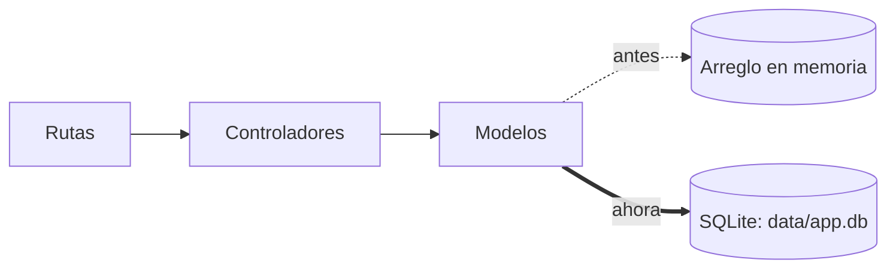

# Guía de Base de Datos: de un arreglo en memoria a SQLite

**Fundamentos Web · Grupo 611 · UNIAJC** · Complemento del [README](../README.md)

Esta guía tiene dos partes:

| Parte | Para quién | Cuándo | Tiempo aprox. |
| --- | --- | --- | --- |
| **[A. Onboarding](#parte-a-onboarding-qué-es-una-base-de-datos)**: qué es una base de datos y SQL básico | **Todo el curso.** Si nunca has trabajado con bases de datos, empieza aquí. | **Obligatoria** · entrega domingo 29 de nov., 11:59 p. m. | 1,5 a 2 horas |
| **[B. Integración](#parte-b-conectar-la-api-a-sqlite)**: conectar tu API a SQLite | Todo el curso | **Avance autónomo (bonus)** · se termina y revisa en la próxima clase presencial | 2 a 3 horas |

**Prerrequisito de la Parte B:** tener la Parte 3 del README terminada (código separado en `routes/`, `controllers/` y `models/`).

---

## Parte A: Onboarding, ¿qué es una base de datos?

> No necesitas saber nada de bases de datos para empezar aquí. Al final vas a poder crear una tabla y hacer las 4 operaciones CRUD con SQL.

### A.1 ¿Por qué necesitamos una base de datos?

Hoy tus tareas viven en un **arreglo dentro de la memoria del servidor**. Cuando el servidor se apaga (o nodemon lo reinicia), la memoria se borra y los datos desaparecen. Es como escribir en un tablero: sirve mientras estás en clase, pero al otro día ya no está.

| Dónde guardar | Cómo funciona | Problema |
| --- | --- | --- |
| Arreglo en memoria | Variable `let tareas = [...]` | Se pierde al reiniciar. |
| `localStorage` | En el navegador del usuario | Solo lo ve ese navegador; no se comparte entre usuarios. |
| Archivo JSON | Leer y reescribir un archivo completo (lo hace `2_GUIA_AVANZADA.md` de newspaper-api) | Lento con muchos datos; si dos peticiones escriben a la vez, una pisa a la otra; buscar es manual. |
| **Base de datos** | Un programa especializado en guardar, buscar y modificar datos | Hay que aprender SQL (para eso es esta guía). |

Una **base de datos** guarda la información de forma **permanente**, permite **buscar rápido**, **valida** los datos (por ejemplo, que un título no esté vacío) y soporta **muchos usuarios a la vez**.

### A.2 Tablas, filas y columnas

Piensa en una base de datos relacional como un **libro de Excel**:

| Excel | Base de datos | En nuestra API |
| --- | --- | --- |
| Libro | Base de datos | `app.db` |
| Hoja | **Tabla** | `tareas`, `contactos` |
| Encabezado de columna | **Columna** (campo) | `titulo`, `completada` |
| Fila | **Fila** (registro) | Una tarea |

Tu objeto de JavaScript ya tiene esa forma. Cada objeto del arreglo es una **fila** y cada propiedad es una **columna**:

```js
{ id: 1, titulo: 'Aprender Express', completada: false }
```

Tabla **`tareas`**:

| id | titulo | completada |
| --- | --- | --- |
| 1 | Aprender Express | 0 |
| 2 | Crear una API REST | 0 |
| 3 | Probar la API | 1 |

Tres ideas clave:

- **Tipo de dato:** cada columna tiene un tipo. En SQLite usaremos `INTEGER` (números enteros) y `TEXT` (texto). SQLite **no tiene tipo booleano**: `true`/`false` se guarda como `1`/`0`.
- **Clave primaria (`PRIMARY KEY`):** la columna que identifica **cada fila de forma única**, nuestro `id`. Con `AUTOINCREMENT`, la base de datos genera el siguiente número sola (ya no necesitas `siguienteId++`).
- **`NOT NULL`:** la columna es obligatoria. Si intentas guardar una fila sin ese valor, la base de datos **la rechaza**. Es una validación extra, además de la que haces en el controlador.

### A.3 ¿Qué base de datos vamos a usar y por qué?

Hay dos grandes familias:

- **Relacionales (SQL):** datos en tablas, se consultan con el lenguaje **SQL**. Ejemplos: **SQLite**, **MySQL**, **PostgreSQL**, SQL Server.
- **No relacionales (NoSQL):** datos en documentos tipo JSON, sin tablas fijas. Ejemplo: MongoDB.

Usaremos **SQLite** porque:

- **No hay que instalar nada:** desde la versión 22.13, Node.js trae SQLite incorporado (módulo `node:sqlite`).
- **Es un solo archivo** (`app.db`): no hay un servidor de base de datos aparte que configurar, ni usuarios ni contraseñas.
- **El SQL que aprendas sirve igual** en MySQL y PostgreSQL. Cambiar después de motor es cambiar la conexión, no lo que aprendiste.

Comprueba que tu Node lo trae (debe imprimir `SQLite listo`):

```bash
node -e "require('node:sqlite'); console.log('SQLite listo')"
```

Si sale `No such built-in module: node:sqlite`, tu Node es muy viejo: instala la versión **LTS** desde [nodejs.org](https://nodejs.org) y vuelve a intentarlo.

### A.4 SQL en 15 minutos

**SQL** (*Structured Query Language*) es el lenguaje para hablar con una base de datos relacional. Cada operación CRUD de tu API tiene su sentencia SQL:

| CRUD | Verbo HTTP | SQL | Ejemplo |
| --- | --- | --- | --- |
| **C**reate | `POST /tareas` | `INSERT` | `INSERT INTO tareas (titulo) VALUES ('Estudiar');` |
| **R**ead | `GET /tareas` | `SELECT` | `SELECT * FROM tareas;` |
| **R**ead uno | `GET /tareas/3` | `SELECT ... WHERE` | `SELECT * FROM tareas WHERE id = 3;` |
| **U**pdate | `PUT /tareas/3` | `UPDATE ... WHERE` | `UPDATE tareas SET completada = 1 WHERE id = 3;` |
| **D**elete | `DELETE /tareas/3` | `DELETE ... WHERE` | `DELETE FROM tareas WHERE id = 3;` |

Y una más, para **crear la tabla** (se hace una sola vez):

```sql
CREATE TABLE tareas (
  id         INTEGER PRIMARY KEY AUTOINCREMENT,
  titulo     TEXT    NOT NULL,
  completada INTEGER NOT NULL DEFAULT 0
);
```

Se lee: "crea la tabla `tareas` con tres columnas; `id` es un entero que identifica cada fila y se autoincrementa; `titulo` es texto obligatorio; `completada` es un entero obligatorio que vale `0` si no lo envías".

Más cosas útiles de `SELECT`:

```sql
SELECT titulo FROM tareas;                         -- solo algunas columnas
SELECT * FROM tareas WHERE completada = 0;         -- filtrar
SELECT * FROM tareas ORDER BY titulo;              -- ordenar (ASC por defecto, o DESC)
SELECT COUNT(*) AS total FROM tareas;              -- contar
SELECT * FROM contactos WHERE ciudad = 'Cali' AND nombre LIKE 'A%';  -- varias condiciones; LIKE 'A%' = empieza por A
```

> ⚠️ **La regla de oro:** `UPDATE` y `DELETE` **siempre llevan `WHERE`**. `DELETE FROM tareas;` (sin `WHERE`) borra **todas** las filas, y no pregunta.

Detalles de sintaxis que confunden al principio:

- Los textos van entre **comillas simples**: `'Cali'`. Los números, sin comillas: `3`.
- Cada sentencia termina en `;`.
- Las palabras clave (`SELECT`, `FROM`…) no distinguen mayúsculas, pero por convención se escriben en mayúscula.
- Los comentarios empiezan con `--`.

### A.5 Practica sin instalar nada: el playground

El repo trae un **playground** que ejecuta un archivo `.sql` contra una base de datos SQLite **en memoria** y te muestra el resultado de cada sentencia. Cada vez que lo corres empieza vacío, así que **no puedes dañar nada**.

1. Abre [`docs/sql/practica.sql`](sql/practica.sql). La **Parte 1 (tareas)** está resuelta.
2. Ejecútalo:

   ```bash
   npm run sql
   ```

3. Verás algo así:

   ```
   ▶ [5] SELECT * FROM tareas
   ┌─────────┬────┬──────────────────────┬────────────┐
   │ (index) │ id │ titulo               │ completada │
   ├─────────┼────┼──────────────────────┼────────────┤
   │ 0       │ 1  │ 'Aprender Express'   │ 0          │
   │ 1       │ 2  │ 'Crear una API REST' │ 0          │
   │ 2       │ 3  │ 'Probar la API'      │ 1          │
   └─────────┴────┴──────────────────────┴────────────┘
   ...
   ▶ [10] INSERT INTO tareas (completada) VALUES (0)
     ✖ ERROR: NOT NULL constraint failed: tareas.titulo
   ```

   El último error es **a propósito**: muestra que `NOT NULL` protege tus datos.

4. **Experimenta:** cambia valores, agrega `INSERT`, quita un `WHERE` y mira qué pasa. Vuelve a ejecutar.
5. Resuelve la **Parte 2 (contactos)**: 9 `TODO` con lo que viste en A.4.

> El playground separa las sentencias por el `;` al **final de la línea**. Si una sentencia no se ejecuta, revisa que termine en `;`.

### A.6 Entregables del onboarding

1. **`docs/sql/practica.sql`** con los 9 `TODO` de contactos resueltos. Al correr `npm run sql`, todos deben salir `✔ OK` o con una tabla de resultado, **excepto** el TODO 9, que debe fallar y tener tu explicación.
2. **`docs/modelo-datos.md`**: el diseño de tus dos tablas, en este formato:

   ```markdown
   ## Tabla: tareas
   | Columna    | Tipo    | Obligatoria | Notas                         |
   | ---------- | ------- | ----------- | ----------------------------- |
   | id         | INTEGER | sí          | PRIMARY KEY, AUTOINCREMENT    |
   | titulo     | TEXT    | sí          |                               |
   | completada | INTEGER | sí          | 0 = pendiente, 1 = completada |

   ## Tabla: contactos
   (complétala tú)
   ```

### A.7 Videos y lecturas

| Recurso | Para qué |
| --- | --- |
| 📰 [freeCodeCamp en español: *Aprende SQL, curso desde cero* (Sergie Code)](https://www.freecodecamp.org/espanol/news/aprende-sql-curso-desde-cero-en-espanol/) | Curso gratis de SQL. Para este onboarding bastan las secciones de fundamentos: tablas, tipos, `CREATE`, `INSERT`, `SELECT`, `UPDATE`, `DELETE`. |
| 🎥 [midudev, clase 5: *Crea una base de datos MySQL y evita los hackers*](https://www.youtube.com/watch?v=eCWNQfzuuso) | La misma API de películas de las clases anteriores conectada a **MySQL**. Fíjate en dos cosas: que **solo cambia el modelo** y la parte de **inyección SQL**. Usa MySQL (requiere instalarlo); nosotros usaremos SQLite, pero los conceptos son los mismos. |
| 📁 [midudev/curso-node-js, `clase-5`](https://github.com/midudev/curso-node-js/tree/main/clase-5) | Código de la clase anterior: compara `models/local-file-system/movie.js` con `models/mysql/movie.js`. Mismas funciones, distinto almacenamiento. |
| 📄 [Node.js: documentación de `node:sqlite`](https://nodejs.org/api/sqlite.html) | Referencia oficial del módulo que usarás en la Parte B (en inglés). |
| 📄 [`3_GUIA_SQLITE.md` de newspaper-api](https://github.com/uniajc-gperezm/newspaper-api/blob/main/3_GUIA_SQLITE.md) | La misma idea aplicada a la API de noticias, con las librerías `sqlite` + `sqlite3`. Útil como segunda explicación. |

---

## Parte B: Conectar la API a SQLite

> 🚀 **Avance autónomo (bonus).** Síguela paso a paso cuando tengas terminadas la Parte 3 del README y la Parte A de esta guía. Si llegas hasta B.7 con tareas funcionando, ya tienes el bonus en camino; B.8 (contactos) lo completamos y revisamos juntos en la próxima clase presencial.
>
> **Antes de empezar, haz commit** de lo que tienes funcionando (`git add . && git commit -m "..."`). Si algo se rompe en la Parte B, vuelves a ese punto con `git restore .`.

### B.1 El plan

Solo vamos a tocar la capa de **modelos**. Rutas y controladores **no cambian**: esa es la ganancia de la Parte 3.



Archivos nuevos o modificados:

```
src/
├── db/
│   ├── schema.sql          ← NUEVO: CREATE TABLE de tareas y contactos
│   └── connection.js       ← NUEVO: abre la BD y crea las tablas
└── models/
    ├── tarea.model.js      ← SE REESCRIBE con SQL
    └── contacto.model.js   ← SE REESCRIBE con SQL (ejercicio)
data/
└── app.db                  ← lo crea SQLite solo; NO se sube a GitHub
```

### B.2 No subir la base de datos a GitHub

El archivo `.db` contiene **datos**, no código (igual que `node_modules` contiene dependencias). Agrega estas líneas al `.gitignore`:

```gitignore
/node_modules
/data
*.db
```

### B.3 El esquema: `src/db/schema.sql`

El mismo SQL que practicaste en el onboarding. `IF NOT EXISTS` permite ejecutarlo cada vez que arranca el servidor sin error si las tablas ya existen.

```sql
CREATE TABLE IF NOT EXISTS tareas (
  id         INTEGER PRIMARY KEY AUTOINCREMENT,
  titulo     TEXT    NOT NULL,
  completada INTEGER NOT NULL DEFAULT 0
);

-- TODO (B.8): CREATE TABLE IF NOT EXISTS contactos (...)
-- Usa el diseño de tu docs/modelo-datos.md
```

### B.4 La conexión: `src/db/connection.js`

Se abre **una sola vez** cuando arranca el servidor, y todos los modelos reutilizan la misma conexión.

```js
const fs = require('node:fs');
const path = require('node:path');
const { DatabaseSync } = require('node:sqlite');

// La BD vive en <raíz del proyecto>/data/app.db
const carpetaDatos = path.join(__dirname, '..', '..', 'data');
fs.mkdirSync(carpetaDatos, { recursive: true }); // crea /data si no existe

const db = new DatabaseSync(path.join(carpetaDatos, 'app.db'));

// ¿La tabla ya existía? (sqlite_master es el "índice" interno de SQLite)
const existiaTareas = db
  .prepare("SELECT 1 FROM sqlite_master WHERE type = 'table' AND name = 'tareas'")
  .get() !== undefined;

// Crear las tablas (si no existen) leyendo schema.sql
const esquema = fs.readFileSync(path.join(__dirname, 'schema.sql'), 'utf8');
db.exec(esquema);

// Datos iniciales: SOLO cuando la tabla se acaba de crear.
// (Si revisáramos "tabla vacía", al borrar todas las tareas por la API
//  y reiniciar, los ejemplos volverían a aparecer.)
if (!existiaTareas) {
  const insertar = db.prepare('INSERT INTO tareas (titulo) VALUES (?)');
  insertar.run('Aprender Express');
  insertar.run('Crear una API REST');
  insertar.run('Conectar una base de datos');
}

module.exports = db;
```

Cómo funciona `node:sqlite`, en cinco métodos:

| Método | Para qué | Devuelve |
| --- | --- | --- |
| `db.exec(sql)` | Ejecutar SQL sin parámetros ni resultado (crear tablas) | nada |
| `db.prepare(sql)` | Preparar una sentencia con `?` | una sentencia (`stmt`) |
| `stmt.all(...valores)` | `SELECT` de **varias** filas | arreglo de objetos (vacío si no hay) |
| `stmt.get(...valores)` | `SELECT` de **una** fila | un objeto, o `undefined` si no existe |
| `stmt.run(...valores)` | `INSERT`, `UPDATE`, `DELETE` | `{ changes, lastInsertRowid }` |

- `changes`: cuántas filas se afectaron. Si es `0` en un `UPDATE`/`DELETE`, **el id no existía** → `404`.
- `lastInsertRowid`: el `id` que la BD le asignó a la fila recién insertada.

### B.5 ⚠️ Inyección SQL: por qué SIEMPRE usamos `?`

Nunca armes el SQL pegando texto que viene del usuario:

```js
// ❌ PELIGROSO: NUNCA hagas esto
db.exec(`DELETE FROM tareas WHERE id = ${req.params.id}`);
```

Si alguien hace la petición `DELETE /tareas/1%20OR%201=1` (los `%20` son espacios codificados en la URL), `req.params.id` vale `"1 OR 1=1"` y el SQL queda `DELETE FROM tareas WHERE id = 1 OR 1=1`, y como `1=1` siempre es verdad, **borra todas las tareas**. Eso es una **inyección SQL**, uno de los ataques más comunes de la web (el "evita los hackers" del video de midudev).

```js
// ✅ SEGURO: el valor viaja aparte y SQLite lo trata solo como dato
db.prepare('DELETE FROM tareas WHERE id = ?').run(id);
```

Cada `?` se reemplaza, en orden, por los valores que pasas a `run`, `get` o `all`. Nunca se interpreta como código SQL.

### B.6 El modelo con SQL: `src/models/tarea.model.js`

Compáralo con tu versión en memoria: **mismos nombres de función, mismos parámetros, mismo tipo de retorno**. Por eso el controlador no se entera del cambio.

```js
const db = require('../db/connection');

// SQLite guarda completada como 0/1. La API debe seguir respondiendo
// true/false, así que convertimos cada fila antes de devolverla.
function aTarea(fila) {
  if (!fila) return null;
  return { id: fila.id, titulo: fila.titulo, completada: fila.completada === 1 };
}

async function obtenerTodas() {
  const filas = db.prepare('SELECT * FROM tareas ORDER BY id').all();
  return filas.map(aTarea);
}

async function obtenerPorId(id) {
  const fila = db.prepare('SELECT * FROM tareas WHERE id = ?').get(id);
  return aTarea(fila);
}

async function crear({ titulo }) {
  const resultado = db.prepare('INSERT INTO tareas (titulo) VALUES (?)').run(titulo);
  return obtenerPorId(Number(resultado.lastInsertRowid));
}

async function actualizar(id, { titulo, completada }) {
  const actual = await obtenerPorId(id);
  if (!actual) return null;

  const nuevoTitulo = titulo ?? actual.titulo;
  const nuevaCompletada = completada ?? actual.completada;

  db.prepare('UPDATE tareas SET titulo = ?, completada = ? WHERE id = ?')
    .run(nuevoTitulo, nuevaCompletada ? 1 : 0, id); // booleano → 0/1
  return obtenerPorId(id);
}

async function eliminar(id) {
  const resultado = db.prepare('DELETE FROM tareas WHERE id = ?').run(id);
  return resultado.changes > 0; // false = el id no existía
}

module.exports = { obtenerTodas, obtenerPorId, crear, actualizar, eliminar };
```

> Si tu modelo en memoria tenía otros nombres de función (por ejemplo `getAll` en vez de `obtenerTodas`), **conserva los tuyos**: lo importante es que coincidan con lo que llama tu controlador.

### B.7 ¡A probar!

1. `npm run dev`. Debe aparecer la carpeta `data/` con `app.db`.
2. Ejecuta tu `api.http` completo: **todo debe responder igual que antes**, con los mismos códigos de estado.
3. **La prueba de fuego:** crea una tarea, detén el servidor (`Ctrl + C`), vuélvelo a iniciar y haz `GET /tareas`. **La tarea sigue ahí.** 🎉
4. *(Opcional)* Para ver la BD como tabla, instala en VS Code la extensión **SQLite Viewer** y abre `data/app.db`.

### B.8 Ejercicio: contactos (avánzalo; lo cerramos en clase)

1. Agrega el `CREATE TABLE IF NOT EXISTS contactos` a `schema.sql` (usa tu `docs/modelo-datos.md`).
2. Reescribe `src/models/contacto.model.js` con SQL, siguiendo `tarea.model.js`.
3. Datos iniciales: inserta 3 contactos inventados **solo cuando la tabla se acaba de crear** (mismo patrón `existiaTareas` de B.4).
4. Tu `api.http` de contactos debe dar los mismos resultados que en memoria.
5. Commit: `git commit -m "feat(db): persistencia de tareas y contactos con SQLite"`

**Reto:** implementa `GET /contactos?ciudad=Cali` con `WHERE ciudad = ?`, sin filtrar en JavaScript.

### B.9 Errores comunes con la base de datos

| Síntoma | Causa | Solución |
| --- | --- | --- |
| `No such built-in module: node:sqlite` | Node anterior a 22.13 | Instala la LTS de nodejs.org (A.3). |
| `ExperimentalWarning: SQLite is an experimental feature` | Aviso de Node: el módulo es nuevo | Es normal, no es un error. Tu API funciona. |
| `NOT NULL constraint failed: tareas.titulo` | Llegó al `INSERT` un valor vacío | La validación del controlador debe atajarlo antes con un `400`. |
| `Provided value cannot be bound to SQLite parameter 2` | Pasaste un tipo que SQLite no acepta, casi siempre un booleano (`true`/`false`) o `undefined` | Convierte booleanos a `1`/`0` y usa `??` para no pasar `undefined`. |
| `no such table: contactos` | La tabla no está en `schema.sql` o tiene otro nombre | Revisa `schema.sql` y reinicia el servidor. |
| `completada` sale como `1`/`0` en vez de `true`/`false` | Devuelves la fila tal cual sale de SQLite | Pásala por `aTarea()` (B.6). |
| `GET /tareas/1` da `404` y la fila existe | `id` llega como texto | `Number(req.params.id)` en el controlador. |
| Quiero empezar con la BD limpia | | Detén el servidor y borra la carpeta `data/`: se recrea con los datos iniciales al arrancar. |

### B.10 ¿Y después de SQLite?

En un proyecto real con muchos usuarios se suele usar un motor con servidor propio, como **MySQL** o **PostgreSQL**. El cambio es justo lo que muestra midudev en la clase 5:

- Se instala un driver (`mysql2`, `pg`) en lugar de `node:sqlite`.
- La conexión lleva host, usuario y contraseña, que van en **variables de entorno** y **nunca** en el código.
- Las consultas devuelven **promesas** (`await connection.query(...)`). Como tus modelos ya son `async`, los controladores siguen sin cambiar.
- **El SQL y la arquitectura son los mismos que aprendiste aquí.**
