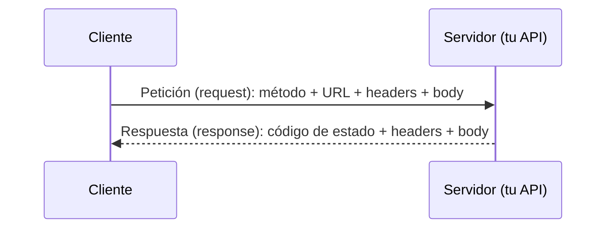
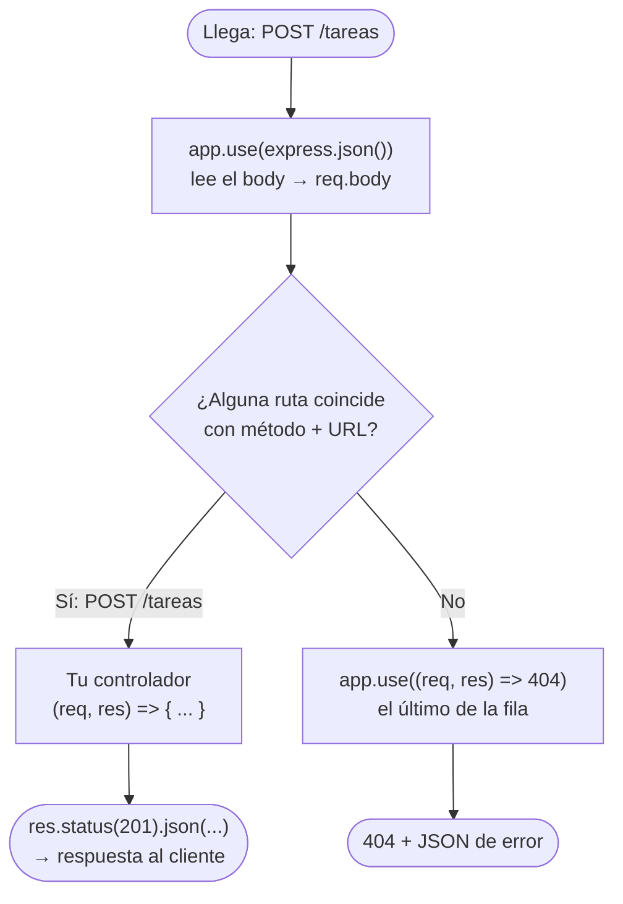

# Cómo funciona HTTP y cómo lo maneja Express

**Fundamentos Web · Grupo 611 · UNIAJC** · Complemento del [README](../README.md)

Cada vez que tu API recibe un `GET /tareas`, por debajo viaja un **mensaje HTTP**. Esta guía te muestra cómo es ese mensaje por dentro y qué hace Express con él. Los ejemplos son **reales**: salen de la API de esta práctica.

## Contenido

1. [Cliente, servidor y HTTP](#1-cliente-servidor-y-http)
2. [Anatomía de una petición](#2-anatomía-de-una-petición-request)
3. [Anatomía de una respuesta](#3-anatomía-de-una-respuesta-response)
4. [Métodos: qué hace cada uno](#4-métodos-qué-hace-cada-uno)
5. [Códigos de estado por familias](#5-códigos-de-estado-por-familias)
6. [El header `Content-Type`](#6-el-header-content-type-el-que-más-problemas-da)
7. [El viaje de una petición dentro de Express](#7-el-viaje-de-una-petición-dentro-de-express)
8. [Chuleta de `req` y `res`](#8-chuleta-de-req-y-res)
9. [Míralo con tus propios ojos](#9-míralo-con-tus-propios-ojos)
10. [Recursos](#10-recursos)

---

## 1. Cliente, servidor y HTTP

- El **cliente** es quien **pide**: el navegador, Thunder Client, REST Client, una app móvil, tu frontend con `fetch`.
- El **servidor** es quien **responde**: tu API Express escuchando en `localhost:3000`.
- **HTTP** (*HyperText Transfer Protocol*) es el **idioma** que usan los dos: unas reglas sobre cómo escribir la petición y la respuesta. Son **mensajes de texto** con un formato fijo.

La regla de oro: **una petición → una respuesta**. El cliente siempre empieza; el servidor nunca "habla" si no le preguntan.



## 2. Anatomía de una petición (request)

Esta es la petición **real** que se envía al crear una tarea (capturada con `curl -v`):

```http
POST /tareas HTTP/1.1
Host: localhost:3000
Content-Type: application/json
Content-Length: 26

{"titulo":"Estudiar HTTP"}
```

| Parte | En el ejemplo | Qué es | En Express |
| --- | --- | --- | --- |
| **Método** | `POST` | La **acción** que pides | `req.method` |
| **Ruta** | `/tareas` | El **recurso** sobre el que actúas (puede llevar `/:id` y `?query`) | `req.params`, `req.query`, `req.originalUrl` |
| **Headers** | `Content-Type: application/json` | **Metadatos**: información *sobre* el mensaje (qué formato trae, cuánto mide, quién lo envía…) | `req.headers`, `req.get('Content-Type')` |
| *Línea en blanco* | | Separa los headers del body | |
| **Body** | `{"titulo":"Estudiar HTTP"}` | Los **datos** que envías. Los `GET` y `DELETE` normalmente no llevan. | `req.body` (gracias a `express.json()`) |

## 3. Anatomía de una respuesta (response)

Y esta es la respuesta **real** de tu API:

```http
HTTP/1.1 201 Created
X-Powered-By: Express
Content-Type: application/json; charset=utf-8
Content-Length: 52

{"id":4,"titulo":"Estudiar HTTP","completada":false}
```

| Parte | En el ejemplo | Qué es | Quién la pone |
| --- | --- | --- | --- |
| **Código de estado** | `201 Created` | **Cómo salió** la petición, en un número | Tú, con `res.status(201)` |
| **Headers** | `Content-Type: application/json; charset=utf-8` | Metadatos de la respuesta | Express, automáticamente al usar `res.json()` |
| **Body** | `{"id":4,...}` | Los datos que devuelves | Tú, con `res.json(nueva)` |

Fíjate: **tú solo escribiste** `res.status(201).json(nueva)`. Express armó el resto del mensaje: convirtió el objeto a texto JSON, calculó el `Content-Length` y puso el `Content-Type`.

## 4. Métodos: qué hace cada uno

| Método | Para qué | ¿Lleva body? | ¿Cambia datos? | En la práctica |
| --- | --- | --- | --- | --- |
| `GET` | Leer | No | **No**, nunca | `GET /tareas`, `GET /tareas/1` |
| `POST` | Crear | Sí | Sí | `POST /tareas` |
| `PUT` | Actualizar (reemplazar) | Sí | Sí | `PUT /tareas/1` |
| `PATCH` | Actualizar una parte | Sí | Sí | Reto `PATCH /tareas/1/completar` |
| `DELETE` | Eliminar | No | Sí | `DELETE /tareas/1` |

> Cuando escribes una URL en el navegador y das Enter, el navegador hace un **`GET`**. Por eso desde la barra de direcciones no puedes probar `POST`, `PUT` ni `DELETE` y necesitas REST Client o Thunder Client.

## 5. Códigos de estado por familias

El **primer dígito** dice de quién fue el problema, si lo hubo:

| Familia | Significado | Los que usas |
| --- | --- | --- |
| `2xx` | ✅ **Éxito** | `200 OK`, `201 Created`, `204 No Content` |
| `3xx` | ↪️ Redirección: "búscalo en otro lado" | (no los usamos) |
| `4xx` | 🙋 **Error del cliente**: pidió algo mal | `400 Bad Request`, `404 Not Found` |
| `5xx` | 💥 **Error del servidor**: falló tu código | `500 Internal Server Error` |

Por eso un `POST` con datos inválidos debe responder **`400`** (la culpa es del cliente) y nunca **`500`** (eso diría que tu código se rompió).

## 6. El header `Content-Type`: el que más problemas da

`Content-Type` le dice al receptor **en qué formato viene el body**. Para nuestra API siempre es `application/json`.

Los casos que vas a ver (probados con esta API):

| Lo que envía el cliente | Qué pasa en Express |
| --- | --- |
| Body JSON **con** `Content-Type: application/json` | ✅ `express.json()` lo convierte y queda en `req.body`. |
| Body JSON **sin** `Content-Type` | `express.json()` **no lo lee** (no sabe que es JSON). `req.body` queda `undefined` → por eso el `req.body ?? {}` del Paso 0.2. |
| JSON **mal escrito** (ej. `{"titulo": "x",}`, con una coma de más) | `express.json()` lo rechaza solo, con **`400`**, antes de llegar a tu ruta. |

En `api.http` el header se escribe justo debajo de la línea del método, y el body va **después de una línea en blanco**:

```http
POST http://localhost:3000/tareas
Content-Type: application/json

{
  "titulo": "Estudiar HTTP"
}
```

## 7. El viaje de una petición dentro de Express

Express procesa cada petición como una **fila de funciones**, en el **orden** en que las registraste con `app.use(...)`, `app.get(...)`, etc. Cada función puede **responder** (y ahí termina el viaje) o **pasar** la petición a la siguiente.



Por eso el **orden importa** en `server.js`:

1. `app.use(express.json())` va **antes** de las rutas: si va después, las rutas reciben `req.body` vacío.
2. Las rutas (`app.use('/tareas', tareasRoutes)`) van en el medio.
3. El manejador del **404** va de **último**: solo debe llegar ahí lo que ninguna ruta atendió.

### ¿Qué es un middleware?

Un **middleware** es una función que está en esa fila y recibe `(req, res, next)`. Puede responder, o llamar a `next()` para pasarle la petición a la siguiente. `express.json()` es un middleware. Puedes escribir el tuyo; este imprime cada petición que llega:

```js
// En server.js, ANTES de las rutas
app.use((req, res, next) => {
  console.log(`${req.method} ${req.originalUrl}`);
  next(); // ← sin esto, la petición se queda "colgada" y el cliente nunca recibe respuesta
});
```

Haz una petición y mira la terminal: verás algo como `POST /tareas`.

📖 [Express: uso de middleware](https://expressjs.com/es/guide/using-middleware.html)

## 8. Chuleta de `req` y `res`

**`req`** (*request*): lo que **llegó**.

| Propiedad | Ejemplo con `PUT /tareas/3?x=1` | Notas |
| --- | --- | --- |
| `req.method` | `'PUT'` | |
| `req.originalUrl` | `'/tareas/3?x=1'` | La URL completa que pidió el cliente |
| `req.params` | `{ id: '3' }` | Lo que va en `/:id`. **Siempre texto.** |
| `req.query` | `{ x: '1' }` | Lo que va después de `?`. **Siempre texto.** |
| `req.body` | `{ completada: true }` | Solo si llegó JSON con su `Content-Type` |
| `req.get('Content-Type')` | `'application/json'` | Leer un header |

**`res`** (*response*): lo que vas a **devolver**.

| Método | Qué hace |
| --- | --- |
| `res.status(código)` | Pone el código de estado. **No envía nada** todavía: se encadena con `.json()` o `.send()`. |
| `res.json(objeto)` | Convierte el objeto a JSON, pone `Content-Type: application/json` y **envía**. |
| `res.send(texto)` | Envía texto o HTML. |
| `res.status(204).send()` | Envía una respuesta **sin body**. |

> ⚠️ **Una petición = una respuesta.** Si llamas `res.json()` dos veces en la misma petición, Express lanza `Cannot set headers after they are sent to the client`. Casi siempre es porque faltó un `return` antes de un `res.status(404).json(...)`. Ver [Repaso JS: funciones](REPASO_JAVASCRIPT.md#5-funciones).

📖 [Express 5: referencia de `req` y `res`](https://expressjs.com/en/5x/api.html) (en inglés)

## 9. Míralo con tus propios ojos

- **Navegador:** `F12` → pestaña **Red** (*Network*) → recarga <http://localhost:3000/tareas> → clic en la petición. Verás los headers, el código de estado y el body. [Guía de Chrome DevTools: Network](https://developer.chrome.com/docs/devtools/network?hl=es).
- **REST Client:** al enviar una petición desde `api.http`, el panel de la derecha muestra la respuesta **completa**: código, headers y body.
- **Terminal:** `curl -v http://localhost:3000/tareas` muestra la petición (líneas con `>`) y la respuesta (líneas con `<`), como en las secciones 2 y 3.

**Ejercicio rápido (5 min):** con la pestaña Network abierta, haz `GET /tareas/1` y `GET /tareas/999`. Para cada una, anota el **código de estado**, el **`Content-Type`** de la respuesta y el **body**.

## 10. Recursos

| Recurso | Para qué |
| --- | --- |
| 🎥 [midudev: *Creamos una API desde cero* (clase 2)](https://www.youtube.com/watch?v=YmZE1HXjpd4) | La primera parte arma un servidor con el módulo `http` de Node **sin Express**: ahí se ve que códigos de estado, headers y body los pones tú a mano. Después se ve cuánto te ahorra Express. |
| 📖 [MDN: generalidades del protocolo HTTP](https://developer.mozilla.org/es/docs/Web/HTTP/Overview) | La explicación de referencia de HTTP, en español. |
| 📖 [MDN: métodos de petición HTTP](https://developer.mozilla.org/es/docs/Web/HTTP/Methods) | Todos los métodos, uno por uno. |
| 📖 [MDN: códigos de estado HTTP](https://developer.mozilla.org/es/docs/Web/HTTP/Status) | Todos los códigos con su significado. |
| 📖 [MDN: headers HTTP](https://developer.mozilla.org/es/docs/Web/HTTP/Headers) | Referencia de headers (`Content-Type`, `Accept`, `Authorization`…). |
| 📖 [Express: guía de rutas](https://expressjs.com/es/guide/routing.html) · [uso de middleware](https://expressjs.com/es/guide/using-middleware.html) | Documentación oficial en español. |

---

Vuelve al [README](../README.md) y sigue con la práctica.
